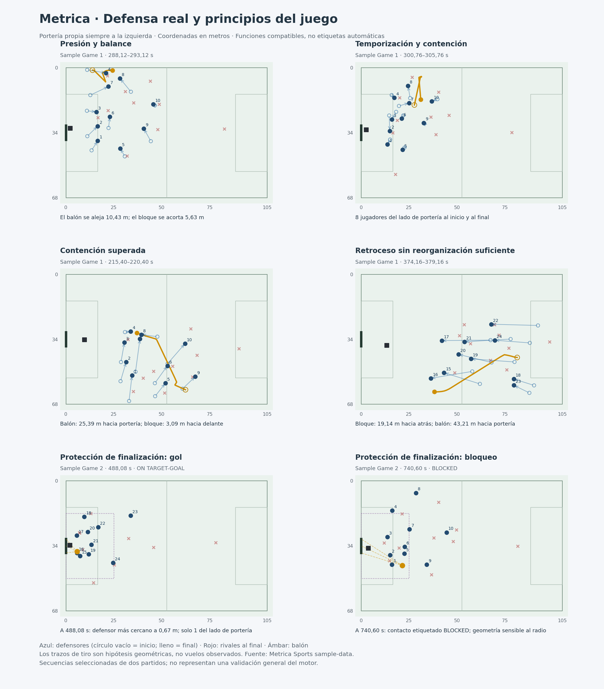

# Defensa real de Metrica y principios del juego

22-10-2026 · Fase Manager · Investigación de 0.53.1, sin cambios del motor.

## Resultado principal

Se han analizado **ocho secuencias reales**: cuatro transiciones tras pérdida de Sample Game 1 y las acciones que preceden a los **cuatro primeros tiros de la primera parte de Sample Game 2**. El análisis relaciona movimientos observados con tus cinco funciones defensivas. No entrena un modelo ni valida todavía una nueva política del juego.

El hallazgo que cambia nuestra dirección de trabajo es que **acercarse al balón, retroceder o acumular jugadores cerca de la portería no bastan, por separado, para describir una defensa eficaz**. Hay que observar simultáneamente el acceso al balón, el control de la progresión, los jugadores que compensan y la relación entre el bloque y la amenaza siguiente. En el gol de Game 2 existe un defensor a 0,67 m del balón; en un bloqueo real, el criterio geométrico de un metro no detecta ninguno de los tres rayos.



## Qué significan las cinco funciones en este análisis

Este es un marco operativo para el proyecto, no una clasificación universal atribuida literalmente a un autor. Temporización y contención se distinguen por su objetivo predominante —ganar tiempo frente a limitar progresión espacial—, pero pueden coincidir. La presión de uno puede coexistir con el retroceso de otros y la protección de la portería. No se obliga al equipo a recorrer cinco estados en orden fijo.

| Función | Intención táctica que buscamos interpretar | Principios y medios relacionados | Evidencia observable que puede apoyarla |
|---|---|---|---|
| **Presión** | Reducir el tiempo y las opciones del poseedor, intentar recuperar cuando existe acceso y respaldo. | Acoso, orientación de la salida, cierre de líneas próximas, cobertura del que salta, balance y reducción coordinada del espacio. | Trayectoria del primer defensor respecto al balón/poseedor, continuidad de sus compañeros, pases y progresión posteriores. Ser el más cercano no acredita presionar. |
| **Temporización** | Retrasar una progresión peligrosa para que lleguen ayudas y se recomponga la defensa. | Control de distancia, ajuste de velocidad, orientación hacia zonas menos amenazantes, evitar una entrada precipitada y conservar posibilidad de intervención. | Intervalo sin ganancia longitudinal rival y con reorganización defensiva; no se deduce intención de un único valor de distancia. |
| **Contención** | Mantener al rival delante y limitar su penetración entre o detrás de los defensores. | Cierre del interior, coberturas escalonadas, compactación contextual, basculación y vigilancia de receptores. | Jugadores del lado de portería, separación y desplazamiento del bloque, rutas de progresión y cambios de receptor. Un bloque corto puede ser superado. |
| **Retroceso** | Recuperar posiciones útiles hacia la portería propia cuando el rival progresa o supera la primera intervención. | Defensa de profundidad, carreras de recuperación, prioridad interior, balance y reorganización de distancias. | Movimiento de los mismos jugadores y del centroide hacia portería, comparado con el avance del balón y los rivales. Correr hacia atrás no garantiza recuperar la estructura. |
| **Protección de zona de finalización** | Dificultar el acceso al remate y su ejecución favorable, conservando opciones de despeje y segunda intervención. | Protección del corredor central y del área, vigilancia del rematador y pase atrás, oposición al tiro, coordinación con portero y control del rebote. | Estado antes del tiro: balón, defensores, posibles rematadores, distancias y evento posterior. Un recuento de jugadores no acredita cobertura efectiva; el tracking disponible no observa altura ni postura corporal. |

Las fuentes formativas primarias apoyan tratar la defensa como una combinación de presión, demora, compactación, cobertura y equilibrio. La FA presenta estas funciones actuando juntas en jugadores, unidades y equipo. FIFA describe la transición como recuperación inmediata del balón o recuperación de la estructura, con reacción próxima y ayudas del resto. **La correspondencia con tus cinco funciones y las interpretaciones de las secuencias son elaboración del proyecto.**

Fuentes del marco: [The FA — Out of possession principles of play](https://community.thefa.com/coaching/b/insights-analysis-blogs/posts/the-out-of-possession-principles-of-play) y [FIFA — Abdallah Idrissi: Recovering shape in defensive transitions](https://www.fifatrainingcentre.com/en/practice/elite-sessions/transition-to-defending/defensive-transitions.php).

## Casos reales y su relación con las funciones

### 1. Presión con acompañamiento del bloque: Game 1, 288,12–293,12 s

El equipo Home acaba de perder la posesión. Su jugador 4 es el más próximo al inicio y recorre **9,96 m** entre extremos. La distancia del defensor más próximo al balón pasa de **2,76 a 3,64 m**. Sin embargo, el balón termina **10,43 m más lejos de la portería defendida**; el centroide de los diez defensores de campo avanza 2,10 m y la longitud del bloque baja de **35,42 a 29,79 m**. La anchura pasa de 45,25 a 39,46 m. Hay cinco jugadores del lado de portería al inicio y seis al final.

**Lectura:** la aproximación local coincide con un desplazamiento colectivo que conserva protección y reduce dimensiones. Es compatible con presión y acompañamiento; que aumente algo la distancia al balón no demuestra ausencia de presión. Tampoco demuestra que la presión causara los pases de seguridad. No hay una recuperación registrada dentro de la ventana y no se presenta como éxito definitivo.

**Para el motor:** evaluar si la aproximación limita la progresión y mantiene el respaldo, no premiar solamente una distancia menor al poseedor.

### 2. Temporización compatible con contención: Game 1, 300,76–305,76 s

El balón se aleja **3,24 m** de la portería propia durante los cinco segundos observados. El equipo conserva **ocho defensores de campo del lado de portería** en ambos extremos. La longitud del bloque disminuye de **25,21 a 23,13 m**, mientras su anchura aumenta de **27,47 a 33,29 m**. La distancia del más próximo al balón pasa de 4,23 a 5,94 m y su identidad cambia del jugador 8 al 10 cerca del final.

**Lectura:** no perseguir siempre la mínima distancia puede coexistir con limitar la progresión. La reducción longitudinal y la ampliación lateral muestran un ajuste contextual, no una compactación uniforme en todas las dimensiones. Lo denominamos **compatible con temporización y contención**, no una intención psicológica identificada ni una ayuda comunicada. Un cambio del jugador geométricamente más cercano tampoco prueba un relevo táctico acordado.

**Para el motor:** separar la función de demora del acto de quedarse inmóvil; medir la continuidad de la protección mientras cambia la referencia del balón.

### 3. Contracaso de contención: Game 1, 215,40–220,40 s

El rival hace progresar el balón **25,39 m hacia la portería**. En esos cinco segundos, el centroide defensor se desplaza **3,09 m en sentido contrario**, alejándose de ella. Los jugadores del lado de portería pasan de **10 a 4**; la longitud aumenta de 32,38 a 36,98 m, aunque la anchura disminuye de 36,05 a 27,00 m. El más cercano cambia sucesivamente entre los jugadores 9, 6, 7 y 8. El pase inicial está etiquetado HEAD: no se asume balón raso ni conducción durante toda la acción.

**Lectura:** estar inicialmente cerca del balón —1,61 m— y estrechar el bloque no evita que la progresión supere relaciones defensivas. El desplazamiento del balón y el de todo el bloque no guardan aquí una continuidad que mantenga a muchos jugadores del lado de portería. Es un contracaso útil, sin atribuir toda la responsabilidad a un jugador ni afirmar un error de consigna del entrenador.

**Para el motor:** detectar cuándo la primera aproximación deja de poder limitar la siguiente progresión y preparar protección de profundidad y receptores.

### 4. Retroceso que no basta: Game 1, 374,16–379,16 s

El centroide retrocede **19,14 m**, pero el balón avanza **43,21 m hacia su portería**. Los jugadores del lado de portería pasan de **6 a 1** y la longitud del bloque aumenta de **34,31 a 43,35 m**. El defensor inicialmente más próximo, jugador 19, termina a 25,65 m del balón; al final otro defensor está a 7,31 m. La referencia geométrica próxima pasa por 19, 20, 15 y 16.

**Lectura:** existe retroceso observado, pero no una recuperación suficiente de las relaciones respecto al balón. No debe calificarse como repliegue eficaz por contar metros corridos hacia atrás. La ventana no incluye un gol ni permite afirmar que ese desenlace vaya a ocurrir.

**Para el motor:** las carreras de recuperación deben proteger rutas de progresión y profundidad; hacen falta métricas de reorganización y acceso después del pase, no solo destinos más retrasados.

### 5. Protección de la zona de finalización: cuatro tiros de Game 2

Se incluyen los cuatro primeros tiros por orden cronológico, sin elegirlos por desenlace. Todas las distancias de la tabla corresponden al frame del inicio del tiro. «Lado de portería» solo significa coordenada longitudinal más próxima a la portería que la del balón; no es una línea de cobertura ni considera fuera de juego. La zona central descriptiva ocupa 25 m de profundidad y 34 m de anchura; **no se equipara al área reglamentaria**.

| Tiro, tiempo | Etiqueta original | Defensor más cercano | Jugadores del lado de portería | Jugadores en zona central | Rayos con proximidad geométrica a 1 / 1,65 / 2 m |
|---|---|---:|---:|---:|---|
| 84 · 176,76 s | OFF TARGET-OUT | 2,67 m | 7 | 6 | 3 / 3 / 3 |
| 199 · 488,08 s | ON TARGET-GOAL | 0,67 m | 1 | 9 | 0 / 0 / 0 |
| 253 · 659,36 s | ON TARGET-SAVED | 2,02 m | 2 | 4 | 3 / 3 / 3 |
| 298 · 740,60 s | BLOCKED | 5,55 m | 4 | 5 | 0 / 2 / 3 |

**Gol del tiro 199:** nueve defensores ocupan la zona central amplia, pero solo uno está más cerca de su portería que el balón. La cercanía de un defensor no garantiza oposición efectiva al golpeo. No se puede atribuir el gol exclusivamente a esa geometría: no observamos altura, perfil corporal o ejecución técnica.

**Parada del tiro 253:** en los seis segundos anteriores, el centroide retrocede **30,92 m**, mientras el balón progresa **42,51 m**. La longitud del bloque pasa de 43,00 a 58,10 m. Hay recuperación hacia la zona de remate y una parada etiquetada, pero eso no demuestra una reorganización colectiva suficiente ni permite adjudicar el mérito a un defensor concreto.

**Bloqueo del tiro 298:** se registra un bloqueo real aunque el defensor más próximo esté a 5,55 m del balón en el inicio del remate. Los tres rayos estáticos cambian de 0 a 3 según el radio descriptivo escogido. Esto impide aceptar el indicador como una verdad física: puede haber intervención durante el vuelo y diferencias de altura o trayectoria. No se identifica al bloqueador con estos datos ni se ajusta el radio para acertar este evento.

**Tiro 84:** tres rayos con proximidad geométrica y siete defensores del lado de portería coinciden con un tiro fuera, no con un bloqueo acreditado. No se inventa una recuperación o intervención defensiva a partir del resultado.

## Relación con los espacios de fase

- **Interacción:** acceso y oposición al balón. La distancia se interpreta junto al movimiento, la continuidad del poseedor y el destino de su acción. No es una orden automática de ir al balón.
- **Apoyo mutuo:** la intervención próxima necesita compensación sobre la continuación, el receptor y la profundidad. Las secuencias muestran cambios de proximidad, pero no permiten afirmar comunicación ni resonancia empática.
- **Cooperación:** movimientos del resto del bloque para conservar equilibrio, cerrar el interior y proteger la zona de remate. El centroide ayuda a describirlos, pero puede ocultar que una línea retrocede y otra avanza; no sustituye el análisis de subgrupos.

Esta correspondencia sirve como interpretación funcional del proyecto. No es una validación científica de los espacios de fase ni un modelo de los ocho ámbitos de individualidad.

## Qué cambia en la investigación de Fase Manager

La 0.53.1 se estaba contrastando fundamentalmente con presión local, acceso estimado y tres corredores de tiro. El material real exige ampliar **la unidad de evaluación** antes de añadir otra excepción a esa selección:

1. **Presionante y respaldo:** comparar la aproximación con quién protege el siguiente pase y si queda posibilidad real de ayuda. La identidad no se deduce permanentemente del más cercano.
2. **Tiempo y espacio:** distinguir retardar una amenaza de limitar su penetración; observar cómo responden los compañeros durante ese intervalo.
3. **Continuidad después de la superación:** valorar si el bloque puede recuperar profundidad y rutas interiores tras un pase, además de su distancia instantánea al balón.
4. **Protección de remate:** medir el estado antes del tiro y las intervenciones posteriores; conservar los resultados que contradicen las métricas estáticas.
5. **Mismo escenario, referencias separadas:** futuro ensayo con ataque y balón impuestos por tracking y defensores libres, conservando un control sin movimiento y la defensa observada. Solo después, oposición autónoma. Una coincidencia de trayectorias no acredita calidad táctica ni una defensa observada tiene por qué ser óptima.

No se han implementado estas conductas en el motor ni se afirma que ya reproduzca estas secuencias. El siguiente paso concreto es preparar el **replay defensivo controlado** y su evaluación por subgrupos, usando estos casos como desarrollo y secuencias diferentes para contraste posterior. Estas ventanas no podrán presentarse como reserva no vista.

## Procedencia, calidad y verificación

Datos: [Metrica Sports sample-data](https://github.com/metrica-sports/sample-data). Según la documentación del proveedor, son partidos anonimizados con coordenadas normalizadas, dimensiones 105 × 68 m y eventos/tracking sincronizados. Se conservan los hashes de los archivos efectivamente usados, no se atribuye a los CSV completos el hash de las copias recortadas históricas.

- Game 1: las cuatro ventanas de transición existentes en `data/metrica-analysis.json`, sin consumir su clip marcado como reserva. **114/114 frames completos** entre estas cuatro ventanas.
- Game 2: CSV completos locales; primer tiempo. Se comprueba el orden de los porteros antes de rotar las coordenadas como en los importadores anteriores. Se seleccionan los tiros 84, 199, 253 y 298 exclusivamente por orden de eventos; ventana de seis segundos previos y dos posteriores. **706/804 frames completos**; los incompletos no se rellenan. Los **604/604 frames previos o simultáneos al tiro** son completos: las ausencias están en la parte posterior de tres ventanas y no se convierten en desenlaces inventados.
- Los cálculos se hacen en metros, transformando ambos equipos a portería propia x=0. Los jugadores de campo excluyen los porteros 11 y 25. No se estima perfil corporal a partir de la velocidad.
- Se separa el cambio de distancia causado por el balón del movimiento propio hacia su posición anterior. El nombre del indicador de aproximación no equivale a una etiqueta de presión ni demuestra causalidad.
- Cinco pruebas automatizadas verifican simetría de orientación, muestras ausentes sin puentes, separación de movimiento del balón/defensor, geometría y regeneración exacta de métricas desde los frames guardados. Se conserva el gol con defensor cercano y el bloqueo contrario al umbral de un metro. No se repite toda la batería del motor, porque index.html no cambia.
- La revisión inicial detectó una cuenta incorrecta de frames en el resumen previo al tiro: incluía ausencias posteriores. Se corrigió el corte temporal, se añadió una comprobación y se regeneró el informe antes de verificar los resultados finales. Esa cuenta no se utilizó para seleccionar o sustituir acciones.
- La figura se genera desde los frames reales y se inspecciona visualmente. Sus flechas de desplazamiento unen extremos, no reconstruyen trayectorias intermedias. Los rayos al arco son hipótesis de geometría, no vuelos observados.

Archivos: `data/real-defense-principles.json.gz`, `scripts/analyze_real_defense.py`, `scripts/plot_real_defense.py`, `tests/real_defense_principles.py`. El informe comprimido conserva frames, eventos, muestras válidas/ausentes, métricas y hashes de entrada.

```bash
python scripts/analyze_real_defense.py --raw-directory /ruta/a/metrica-width-full --out data/real-defense-principles.json.gz
python tests/real_defense_principles.py
python scripts/plot_real_defense.py
```

**Estado:** análisis real realizado y principios operacionalizados; sin modificación de index.html o main. 0.53.1 continúa sin aceptar. A2/A4/A7 permanecen abiertos. No se inicia 0.54.
