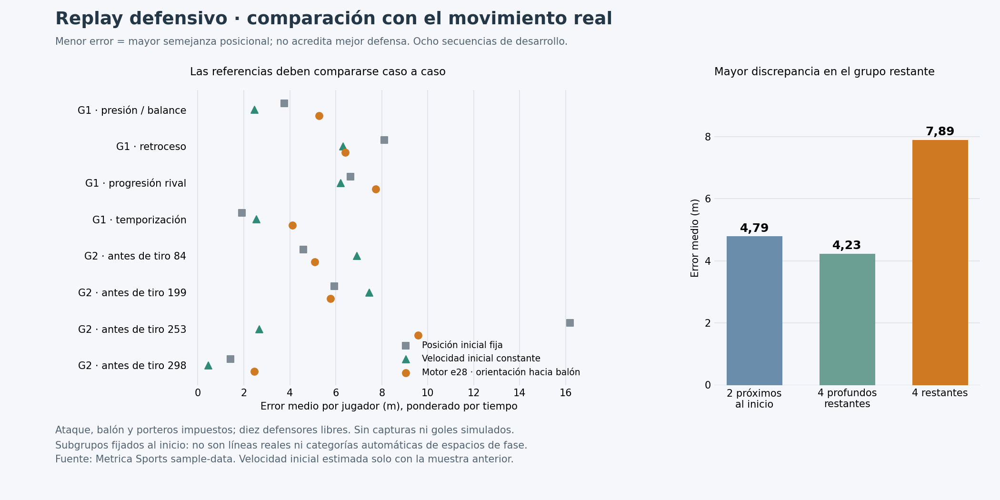

# Replay defensivo real: comparación controlada

22-10-2026. Base comprobada: `codex/fase-manager-0.53.1-resume@1eb24a6`, main `82c6c02`. Se recupera una copia de trabajo aislada desde la rama remota, que incluye la investigación de primera intención y el análisis real posterior. El árbol anterior y sus archivos temporales se conservan. Se consultan contexto, hoja de ruta, registro, reanudación y los evaluadores existentes antes de añadir el nuevo adaptador.

**Entrega:** replay ejecutable con ataque, balón y porteros impuestos por tracking y diez defensores moviéndose con la política y locomoción de cada motor. Comparación de 0.52, 0.53 y e28; referencia observada, posición inicial fija y velocidad inicial constante. No hay una nueva política ni una integración en main. La 0.53.1 sigue sin aceptar; no se inicia 0.54.

## Resultado principal

Las tres versiones superan en semejanza posicional a la referencia estática en **3 de las 8 secuencias** y a la velocidad inicial constante en **2 de 8**, bajo ambas hipótesis de orientación. Las medias globales no cuentan la misma historia que el número de casos: el error muy alto de mantener posiciones fijas durante un gran retroceso aumenta su media. Se conservan ambos indicadores para evitar una lectura favorable por agregación.

| Fuente | Error medio, mirando inicialmente al balón | Error medio, orientados inicialmente en eje de ataque |
|---|---:|---:|
| Defensa observada | 0,000 m por construcción | 0,000 m por construcción |
| Posición inicial fija | 6,071 m | 6,071 m |
| Velocidad inicial constante | 4,370 m | 4,370 m |
| 0.52 | 5,804 m | 5,775 m |
| 0.53 | 5,783 m | 5,766 m |
| e28, propuesta 0.53.1 | 5,805 m | 5,776 m |

Son medias sin ponderar entre clips, calculadas a partir del error euclídeo por jugador e integrado por tiempo dentro de cada clip. No son errores de gol, xG ni una puntuación de calidad táctica. Los dos supuestos corporales son controles de sensibilidad, no dos partidos independientes ni intervalos de confianza.

La principal discrepancia de e28 se concentra en los cuatro jugadores que no estaban inicialmente entre los dos más próximos al balón ni entre los cuatro más profundos restantes: **7,89 m**, frente a **4,79 m** en los próximos y **4,23 m** en los profundos, con orientación inicial hacia balón. Bajo el otro supuesto son 7,78 / 4,86 / 4,23 m. Estos grupos fijan identidades al inicio: no se identifican automáticamente con líneas, roles o espacios de fase reales.



## Qué se ha implementado y qué corrige del montaje anterior

`scripts/evaluate_real_defense_replay.cjs` usa las ocho secuencias ya analizadas y un plan conservado antes de obtener los resultados finales. El evaluador antiguo `evaluate_game2.cjs` mantenía `owner=null` y un objeto de vuelo mínimo; la protección del poseedor podía quedar desactivada. No se modifica ese evaluador histórico. El adaptador nuevo restaura un poseedor únicamente cuando los eventos anotan control; durante un pase el poseedor queda a null hasta su recepción registrada.

Se reutiliza `movement` y la locomoción del motor. La única restricción al movimiento integrado permite avanzar a los diez defensores de campo; los otros doce jugadores conservan las posiciones prescritas. Se respetan lectura almacenada, reacción, aceleración, frenada, giro, órdenes existentes —aquí vacías— y asignación defensiva. La observación de compañeros/rivales se ejecuta en cada paso, como en update. Se comprueba cada paso en pruebas específicas.

La política recibe posiciones actuales, velocidad pasada estimada, equipo con balón y el poseedor actual si está registrado. **No recibe coordenadas privadas del destino de un pase, identidad del receptor antes de la recepción ni la etiqueta de éxito del remate.** Los eventos originales sí están disponibles en el adaptador offline para imponer el estado anotado en cada instante; no se presentan como decisiones que el motor haya inferido.

Durante el tránsito se usa un vuelo de altura desconocida sin endpoint ni receptor privado. No activa el anticipador de pases que requiere esos campos. Esto permite contrastar la organización defensiva disponible sin inventar altura o una trayectoria futura privada, pero no valida la anticipación aérea ni todo el juego de recepción.

## Ventanas y condiciones compartidas

1. Se conservan los cuatro tramos de transición y los cuatro primeros tiros de Game 2 seleccionados previamente. Los tiros se evalúan solo hasta el inicio del remate.
2. Se exige posesión continua del rival para la defensa estudiada. En la ventana del tiro 298, el equipo Home recupera y juega antes de perder; no sería válido moverlo como defensor durante ese tramo. La secuencia defensiva comienza en la recuperación Away de **739,20 s** y termina en **740,60 s**.
3. Se utiliza la segunda muestra completa como estado común inicial y la primera exclusivamente para estimar la velocidad por diferencia hacia atrás. Duraciones efectivas: 4,80 s en cada transición, 5,96 s en los tiros 84/199/253 y 1,36 s en el tiro 298. Esto explica pequeñas diferencias con las medidas de extremos del informe real anterior.
4. Los actores impuestos se reconstruyen linealmente entre muestras completas a pasos de como máximo 1/120 s. No se interpola una muestra ausente ni un jugador que falte. La velocidad entregada al motor usa el par de muestras anterior al intervalo; la reconstrucción offline de posiciones no es una predicción causal de tracking futuro.
5. Se conservan los diez defensores reales por identidad, asignándolos a los slots del motor en orden estable de dorsal, con porteros en slot 1. Esa correspondencia **no identifica sus verdaderas posiciones tácticas o capacidades físicas**. Los perfiles de velocidad/reacción del motor son provisionales.
6. No se conoce la orientación corporal real. Se evalúan dos hipótesis: orientación hacia balón o eje de ataque. Para los defensores son condiciones iniciales, después giran con el motor; para los actores impuestos se mantiene la hipótesis en cada observación. No se confunde vector de carrera con mirada.
7. Los subgrupos son disjuntos y se fijan al inicio en metros: dos más próximos; cuatro más profundos entre los restantes; cuatro restantes. Se conserva su identidad aunque cambie el presionante asignado.

## Comparación por secuencia

Hipótesis inicial hacia balón. Todos los valores son error medio posicional, en metros.

| Secuencia | Posición fija | Velocidad constante | 0.52 | 0.53 | e28 |
|---|---:|---:|---:|---:|---:|
| G1, 288,32–293,12: presión/balance | 3,77 | 2,46 | 5,27 | 5,27 | 5,27 |
| G1, 374,36–379,16: retroceso | 8,12 | 6,31 | 6,40 | 6,40 | 6,40 |
| G1, 215,60–220,40: progresión rival | 6,63 | 6,20 | 7,73 | 7,73 | 7,73 |
| G1, 300,96–305,76: temporización | 1,92 | 2,54 | 4,12 | 4,12 | 4,12 |
| G2, antes del tiro 84 | 4,58 | 6,91 | 5,10 | 5,10 | 5,10 |
| G2, antes del tiro 199 | 5,94 | 7,44 | 5,77 | 5,60 | 5,77 |
| G2, antes del tiro 253 | 16,20 | 2,65 | 9,58 | 9,58 | 9,58 |
| G2, antes del tiro 298 | 1,42 | 0,45 | 2,46 | 2,46 | 2,46 |

La 0.53 distingue algo el tiro 199 y el tiro 298; e28 no aporta una mejora consistente en esta prueba. La diferencia de la 0.53 en el tiro 199 no justifica aceptar su antigua preparación ficticia del tiro. Allí se registran 149 propuestas de protección en consultas de 0.53 y ninguna en e28; son consultas que pueden ser anidadas, no 149 intenciones ejecutadas ni bloqueos.

Se calculan también discrepancias en distancia al balón, jugadores del lado de portería, centroide longitudinal, longitud, anchura, posibles coberturas geométricas y ocupación de la zona central. Los valores y las posiciones por muestra se conservan completos, no solo la tabla favorable o la media final.

## Relación con presión, temporización, contención, retroceso y protección

**Presión y apoyo colectivo.** En la transición 288,32–293,12, los defensores reales avanzan su centroide 1,92 m; e28 lo retrasa 0,34 m. El grupo restante tiene 8,61 m de error. La discrepancia no queda explicada por la elección aislada del primer defensor. No demuestra que copiar el avance real sea siempre la mejor decisión.

**Temporización y contención.** En 300,96–305,76, el bloque real se desplaza poco y termina con ocho jugadores del lado de portería. El motor también termina con ocho, pero genera 4,12 m de error frente a 1,92 de permanecer fijo. Coincidir en el número de jugadores protegidos no implica conservar la misma organización; tampoco la referencia fija sería una política adecuada para todos los contextos.

**Retroceso y reorganización.** En 374,36–379,16, el centroide real retrocede 18,99 m y el simulado 27,40 m. El motor termina con cero jugadores de campo del lado de portería respecto al balón, frente a uno observado. En la aproximación al tiro 253 retrocede 41,01 m frente a 30,73 m y el error del grupo restante llega a 14,63 m. Retroceder más no acredita recuperar profundidad útil o mejores relaciones.

**Contrario a confundir fidelidad y eficacia.** En 215,60–220,40, la defensa real avanza 2,29 m de centroide mientras el rival progresa. El motor retrocede 7,80 m y termina con seis jugadores del lado de portería en vez de cuatro. Tiene más error de trayectoria, pero ese hecho por sí solo no permite afirmar peor defensa: la secuencia observada también contenía una progresión que superaba relaciones defensivas.

**Protección de finalización.** Los tres tramos previos al tiro y el tramo final del 298 permiten comparar acceso, proximidad y ocupación antes del golpeo. No se simula el tiro anotado ni se reproduce su resultado. El gol/parada/bloqueo del partido sigue siendo una etiqueta de referencia; no se contabiliza como un gol o parada del motor.

## Límite principal: replay sin interacción física con el ataque impuesto

El adaptador no ejecuta entradas, capturas, elecciones ofensivas, arbitraje o goles. Es un replay de organización y movimiento: si un defensor se aproxima al balón, la secuencia real continúa impuesta. Con el umbral descriptivo de 1,65 m de proximidad plana, e28 entra en ese rango en seis de las ocho secuencias, y en tres ya está dentro en la muestra inicial. No hay altura observada para certificar contacto. Por tanto, no debe interpretarse el resto del tramo como un partido contrafactual físicamente demostrado. Se conserva el instante de primera proximidad para hacer visible esa limitación.

La referencia de velocidad constante tampoco es una política defensiva: no decide, no frena ni responde al rival. Su mejor semejanza en seis casos evidencia la necesidad de separar continuidad cinemática y selección táctica, no que debamos sustituir el motor por trayectorias inerciales.

## Verificación incremental y reproducibilidad

- Plan conservado antes del contraste final; ninguna búsqueda de parámetros ni sustitución por desenlace. Fuente analizada, eventos, motores y adaptador identificados por SHA-256.
- Piloto final de ocho ejecuciones e28 y comparación completa de **48 ejecuciones**: ocho casos × tres motores × dos orientaciones. Las ocho del piloto coinciden exactamente con la ejecución correspondiente de la comparación completa. Son **56 ejecuciones conservadas de ocho configuraciones**, no 56 partidos independientes. Las pruebas unitarias y borradores no se cuentan como casos nuevos.
- La nueva entrada `tests/real_defense_replay.cjs` comprueba actores/ball impuestos en cada subpaso, activación con poseedor registrado, tránsito sin poseedor ficticio, no dependencia de endpoints privados o resultado del remate, muestras ausentes rechazadas, estados iniciales comunes, referencia observada con error cero, grupos estables, simetría en un intervalo espejo, semilla estable y regeneración de métricas desde las muestras. Al alterar las posiciones defensivas reales futuras, las trayectorias simuladas permanecen idénticas: esos datos solo sirven al observador.
- El primer borrador del test detectó que el grupo restante tenía los mismos miembros pero orden dependiente de las filas del CSV. Se fija su orden por dorsal antes de generar los informes finales. No se modifica ningún umbral para mejorar un resultado.
- Sobre el motor sin cambios pasan presión, revisión y el análisis real anterior (cinco casos Python). Son **cuatro entradas finales**: tres CommonJS —incluida la nueva— y una Python. Se verifica la nueva entrada tanto contra piloto como contra informe completo; no se anuncia una batería completa de las 64 entradas actuales.
- Figura generada desde los resultados e inspeccionada visualmente. Sin prueba visual nueva del juego en Safari/iOS. `index.html` de la rama de investigación conserva el hash de e28; main mantiene el motor publicado 0.53.

```bash
node scripts/evaluate_real_defense_replay.cjs /ruta/a/events.csv data/real-defense-replay-pilot.json.gz pilot
FASE_DEFENSIVE_REPLAY_REPORT=data/real-defense-replay-pilot.json.gz node tests/real_defense_replay.cjs
node scripts/evaluate_real_defense_replay.cjs /ruta/a/events.csv data/real-defense-replay.json.gz full
node scripts/evaluate_real_defense_replay.cjs --summary data/real-defense-replay.json.gz
node tests/real_defense_replay.cjs
python scripts/plot_real_defense_replay.py
```

## Decisión y próximo incremento

El replay controlado está preparado y verificado. La muestra localiza una discrepancia compartida de la organización sin balón, especialmente en el grupo restante, mientras las diferencias entre las tres selecciones de tiro son pequeñas. **No se acepta e28 ni se altera main.**

El siguiente experimento debe registrar y contrastar los destinos de esos jugadores —anclaje tras pérdida, arrastre por el balón, referencia al rival y recuperación de profundidad— en los casos de presión/balance y temporización, conservando también los contrarios de progresión y retroceso. A partir de ahí se podrá probar una modificación acotada de continuidad colectiva, acompañada de los casos sintéticos de presión/bloqueo ya preservados. Las trayectorias reales no deben convertirse automáticamente en objetivos óptimos ni las ventanas usadas en una reserva nueva. La oposición reactiva y los contactos deberán acompañar cualquier candidato antes de aceptar 0.53.1.
